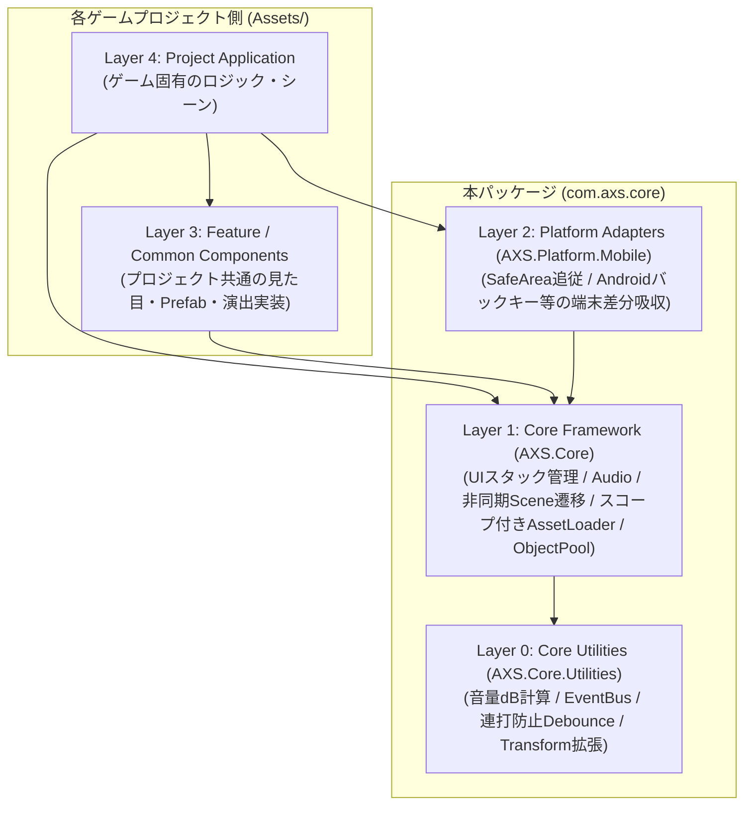

# AXS Core Framework (`com.axs.core`)

Unity（Unity 6 / 6000.0以降）向けのスマートフォンおよびマルチプラットフォーム対応・汎用ゲーム開発基盤（UPMパッケージ）です。  
ゲームジャンルを問わずあらゆる新規プロジェクトでそのまま再利用できる「道具箱（Utilities）」「コアシステム（Framework）」「プラットフォーム差分吸収（Platform Adapters）」を疎結合な階層構造で提供します。

---

## 目次

1. [設計思想とレイヤー構造](#1-設計思想とレイヤー構造)
2. [ディレクトリ構成とファイル一覧](#2-ディレクトリ構成とファイル一覧)
3. [アセンブリ定義（.asmdef）と依存関係](#3-アセンブリ定義asmdefと依存関係)
4. [各機能の詳細と実装サンプル](#4-各機能の詳細と実装サンプル)
   - [Layer 0: Core Utilities (`AXS.Core.Utilities`)](#layer-0-core-utilities-axscoreutilities)
   - [Layer 1: Core Framework (`AXS.Core`)](#layer-1-core-framework-axscore)
   - [Layer 2: Platform Adapters (`AXS.Platform.Mobile`)](#layer-2-platform-adapters-axsplatformmobile)
5. [導入方法（インストール手順）](#5-導入方法インストール手順)
6. [運用・メンテナンス備忘録（開発サイクル）](#6-運用メンテナンス備忘録開発サイクル)

---

## 1. 設計思想とレイヤー構造

「何でも入りの巨大ライブラリ（God Package）」化を防ぎ、ゲームの見た目（Prefab）や特定OS依存の仕様変更に強い設計とするため、明確な **4層（Layer 0〜3）の単方向依存アーキテクチャ** を採用しています。  
本パッケージ（`com.axs.core`）は、そのうちの **Layer 0 〜 Layer 2** を担います。



### 各レイヤーの責務と境界線

| レイヤー | アセンブリ名 | 配置場所 | 役割・ルール |
| :--- | :--- | :--- | :--- |
| **Layer 0** | `AXS.Core.Utilities` | `com.axs.core/Runtime/Utilities` | **外部パッケージ依存ゼロ**。C#標準＋最小限のUnity APIのみで動作する純粋な道具箱。 |
| **Layer 1** | `AXS.Core` | `com.axs.core/Runtime/Framework` | **ジャンル不問の共通骨格**。特定のUIデザイン（画像やPrefab実体）を持たず、ライフサイクルと状態管理のみを担当。 |
| **Layer 2** | `AXS.Platform.Mobile` | `com.axs.core/Runtime/Platform/Mobile` | **OS・ハードウェア差分の吸収**。ノッチ/Dynamic IslandやAndroidの物理戻るボタンなど、端末固有の挙動をLayer 1へ橋渡しする。 |
| **Layer 3** | *(各プロジェクト側)* | `Assets/Common/` 等 | **見た目を持つ共通部品**。ローディング画面Prefabや共通ダイアログPrefabなど、タイトルごとにデザインが変わるもの。 |
| **Layer 4** | *(各プロジェクト側)* | `Assets/Game/` 等 | **ゲーム固有実装**。インゲームロジック、固有UI、各シーンなど。 |

### 技術的特徴
- **UPM（Unity Package Manager）完全準拠**: `package.json` による依存パッケージ（UniTask, Addressables, uGUI）の自動解決と、読み取り専用パッケージとしてのクリーンな隔離。
- **Unity 6000.5+ 最新API準拠**: 旧来の `Object.GetInstanceID()` や `FindObjectOfType()` を廃し、最新の `Object.GetEntityId()`（`EntityId`構造体）および `FindAnyObjectByType()` を採用。

---

## 2. ディレクトリ構成とファイル一覧

```text
com.axs.core/
├── package.json                                      # UPMパッケージ定義・依存関係マニフェスト
├── README.md                                         # 本ドキュメント（設計・機能リファレンス）
├── AGENTS.md                                         # AIエージェント向け常時適用ルール・設計制約
├── .agents/                                          # AIエージェント用スキル格納フォルダ（Unityからは無視される）
│   └── skills/
│       ├── add-framework-feature/SKILL.md            # 新機能追加時のレイヤー選定・.meta生成・検証手順
│       └── release-upm-version/SKILL.md              # バージョン更新・.meta監査・GitタグPush手順
└── Runtime/
    ├── Utilities/                                    # 【Layer 0】純粋ユーティリティ群
    │   ├── AXS.Core.Utilities.asmdef                 # Layer 0 アセンブリ定義（外部依存なし）
    │   ├── Audio/
    │   │   └── AudioMath.cs                          # 線形音量(0~1) ⇔ デシベル(-80~0dB) 相互変換
    │   ├── Extensions/
    │   │   └── TransformExtensions.cs                # Transform初期化・RectTransform全画面ストレッチ拡張
    │   ├── Messaging/
    │   │   └── EventBus.cs                           # 型安全なインプロセス Pub/Sub イベントバス
    │   └── Timing/
    │       └── DebounceUtility.cs                    # ボタン連打・多重実行防止ユーティリティ
    │
    ├── Framework/                                    # 【Layer 1】汎用コアフレームワーク
    │   ├── AXS.Core.asmdef                           # Layer 1 アセンブリ定義（Utilities, UniTask, Addressables参照）
    │   ├── Asset/
    │   │   ├── AddressableScopeLoader.cs             # Addressablesのハンドル自動追跡・一括解放ローダー
    │   │   └── ResourceScopeLoader.cs                # Resources非同期ロード＆生成インスタンス一括破棄ローダー
    │   ├── Audio/
    │   │   ├── AudioChannelType.cs                   # 音声チャンネル定義 (Master / BGM / SE / Voice)
    │   │   └── AudioManager.cs                       # BGMクロスフェード・SE同時再生制限・プール・音量永続化
    │   ├── Pooling/
    │   │   └── GameObjectPool.cs                     # 汎用GameObjectオブジェクトプール（GCスパイク防止）
    │   ├── Scene/
    │   │   ├── ISceneTransitionEffect.cs             # シーン遷移演出（フェード・進捗表示）の抽象インターフェース
    │   │   └── SceneTransitionManager.cs             # UniTaskベースの非同期シーン遷移・演出連携マネージャー
    │   └── UI/
    │       ├── IBackHandler.cs                       # 「戻る」操作ハンドリング用インターフェース
    │       ├── UIElement.cs                          # 画面・モーダル・ダイアログの基底クラス（CanvasGroup制御）
    │       └── UIManager.cs                          # UIスタック（Push/Pop/Close）管理・バックキーディスパッチ
    │
    └── Platform/                                     # 【Layer 2】プラットフォーム特化アダプター
        └── Mobile/
            ├── AXS.Platform.Mobile.asmdef            # Layer 2 アセンブリ定義（AXS.Core, InputSystem参照）
            ├── AndroidBackButtonHandler.cs           # Android戻るキー / ESCキー検知＆UIManager連携
            └── SafeAreaFitter.cs                     # ノッチ・Dynamic Island・ホームバーへのRectTransform自動追従
```

---

## 3. アセンブリ定義（`.asmdef`）と依存関係

コンパイル時間の短縮とレイヤー間の逆方向参照（循環参照）をコンパイラレベルで防ぐため、3つの `.asmdef` に分割しています。

| アセンブリ名 (`name`) | ルート名前空間 (`rootNamespace`) | 参照アセンブリ (`references`) |
| :--- | :--- | :--- |
| `AXS.Core.Utilities` | `AXS.Core.Utilities` | なし |
| `AXS.Core` | `AXS.Core` | `AXS.Core.Utilities`, `UniTask`, `UniTask.Addressables`, `UnityEngine.UI`, `Unity.Addressables`, `Unity.ResourceManager` |
| `AXS.Platform.Mobile` | `AXS.Platform.Mobile` | `AXS.Core`, `AXS.Core.Utilities`, `UniTask`, `UnityEngine.UI`, `Unity.InputSystem` |

> **💡 ゲーム側で独自の `.asmdef` を作る場合の注意点**  
> ゲーム側で `MyGame.asmdef` などを作成する場合は、`References` に `AXS.Core`、`AXS.Core.Utilities`、`AXS.Platform.Mobile`（および `UniTask`）を追加してください。（`.asmdef` を使わない `Assembly-CSharp` 直下のスクリプトからは、`autoReferenced: true` により自動で参照可能です）

---

## 4. 各機能の詳細と実装サンプル

---

### Layer 0: Core Utilities (`AXS.Core.Utilities`)

#### 1. `AudioMath`（音量・デシベル変換）
- **ファイル**: `Runtime/Utilities/Audio/AudioMath.cs`
- **目的**: UIスライダーの線形値（`0.0` 〜 `1.0`）をそのまま `AudioMixer` に渡すと人間の聴覚上不自然になる問題を解決するため、対数デシベル値（`-80dB` 〜 `0dB`）への正確な相互変換を提供します。
- **主なメソッド**:
  - `float LinearToDecibel(float linear)`: `0.0〜1.0` を `-80dB〜0dB` に変換（`0.0001` 以下は `-80dB` として完全消音）。
  - `float DecibelToLinear(float db)`: `-80dB〜0dB` を `0.0〜1.0` に変換。

#### 2. `TransformExtensions`（Transform / RectTransform 拡張メソッド）
- **ファイル**: `Runtime/Utilities/Extensions/TransformExtensions.cs`
- **目的**: 動的生成したUIやオブジェクトの初期化コードを1行で記述できるようにします。
- **主なメソッド**:
  - `transform.ResetLocal()`: `localPosition = zero`, `localRotation = identity`, `localScale = one` に一括リセット。
  - `rectTransform.FillParent()`: 親の `RectTransform` 全面にストレッチするよう `anchorMin(0,0)`, `anchorMax(1,1)`, `offsetMin/Max(0,0)` を一括設定。

#### 3. `EventBus<TEvent>`（型安全 Pub/Sub イベントバス）
- **ファイル**: `Runtime/Utilities/Messaging/EventBus.cs`
- **目的**: シングルトン同士の密結合や直接参照を避け、構造体やクラスをメッセージ型として疎結合にイベント通知を行います。
- **使い方**:
  ```csharp
  using AXS.Core.Utilities;

  // イベント定義（struct推奨）
  public readonly struct PlayerCoinChangedEvent
  {
      public readonly int CurrentCoins;
      public PlayerCoinChangedEvent(int coins) => CurrentCoins = coins;
  }

  // 購読側（UIなど）
  void OnEnable() => EventBus<PlayerCoinChangedEvent>.Subscribe(OnCoinChanged);
  void OnDisable() => EventBus<PlayerCoinChangedEvent>.Unsubscribe(OnCoinChanged);
  void OnCoinChanged(PlayerCoinChangedEvent e) => coinText.text = e.CurrentCoins.ToString();

  // 発行側（ロジックなど）
  EventBus<PlayerCoinChangedEvent>.Publish(new PlayerCoinChangedEvent(100));
  ```

#### 4. `DebounceUtility`（連打・多重タップ防止）
- **ファイル**: `Runtime/Utilities/Timing/DebounceUtility.cs`
- **目的**: スマホゲームで頻発する「ボタンの高速連打による通信やモーダルの二重発火」を、`Time.unscaledTime` ベースで手軽に防止します（ポーズ中 `Time.timeScale = 0` でも正常動作）。
- **使い方**:
  ```csharp
  using AXS.Core.Utilities;

  public void OnSubmitButtonClicked()
  {
      // このコンポーネントのEntityIdをキーにして、0.5秒以内の再実行をブロック
      if (!DebounceUtility.CanExecute(this.GetEntityId(), coolDownSeconds: 0.5f))
      {
          return;
      }
      // 本来の処理
  }
  ```

---

### Layer 1: Core Framework (`AXS.Core`)

#### 1. `UIManager` / `UIElement` / `IBackHandler`（UIスタック＆モーダル制御）
- **ファイル**: `Runtime/Framework/UI/`
- **名前空間**: `AXS.Core.UI`
- **目的**: 複数のモーダルやダイアログが重なった際の「開く・閉じる順番（LIFOスタック）」「アニメーション中の操作ブロック（CanvasGroup制御）」「戻るボタン押下時の最前面クローズ」を一元管理します。
- **各クラスの役割**:
  - `IBackHandler`: `UniTask<bool> OnBackPressedAsync()` を定義するインターフェース。
  - `UIElement`: すべての画面・モーダルの抽象基底クラス。`[RequireComponent(typeof(CanvasGroup))]` を持ち、オープン・クローズ演出中は自動で `interactable` / `blocksRaycasts` を `false` にロックして誤操作を防ぎます。`closeOnBackPressed`（Inspector設定可）が `true` の場合、バックキーで自動的に閉じます。
  - `UIManager`: シングルトン（未配置時は自動生成＋`DontDestroyOnLoad`）。
    - `PushAsync(UIElement)`: スタックの最前面に積んで `OpenAsync()` を実行。
    - `PopAsync()`: 最前面の要素を取り出して `CloseAsync()` を実行。
    - `CloseAsync(UIElement)`: 指定した要素をスタックから除去して閉じる。
    - `CloseAllAsync()`: スタック内の全UIを閉じる。
    - `DispatchBackActionAsync()`: スタック最前面から順に `OnBackPressedAsync()` を呼び出し、消費されたら `true` を返す。
- **使い方（カスタムモーダルの作成と表示）**:
  ```csharp
  using System.Threading;
  using AXS.Core.UI;
  using Cysharp.Threading.Tasks;
  using UnityEngine;

  public class SampleDialog : UIElement
  {
      // 必要に応じてフェードやスケール演出をオーバーライド（省略時は即時表示）
      protected override async UniTask OnOpenAnimationAsync(CancellationToken ct)
      {
          CanvasGroup.alpha = 0f;
          while (CanvasGroup.alpha < 1f)
          {
              CanvasGroup.alpha += Time.unscaledDeltaTime * 5f;
              await UniTask.Yield(PlayerLoopTiming.Update, ct);
          }
          CanvasGroup.alpha = 1f;
      }
  }

  // 呼び出し側
  await UIManager.Instance.PushAsync(sampleDialogInstance);
  // 閉じる時（またはAndroidバックキー / ESCキーで自動的に閉じる）
  await UIManager.Instance.PopAsync();
  ```

#### 2. `AudioManager` / `AudioChannelType`（統合オーディオ管理）
- **ファイル**: `Runtime/Framework/Audio/`
- **名前空間**: `AXS.Core.Audio`
- **目的**:
  1. **BGMのクロスフェード切り替え**: 2つの `AudioSource`（A/B）を内部で交互に使い、自然なクロスフェード再生を実現。
  2. **SEの同フレーム多重再生制限（音割れ防止）**: 敵の同時撃破などで同じSEが1フレームに数十回呼ばれても、`maxSimultaneousSameSe`（デフォルト2個）までに自動で間引き、爆音化を防止。
  3. **SE用 `AudioSource` の自動プーリング**: 初期プール（デフォルト10個）から空きを探して再生し、不足時のみ動的拡張。
  4. **音量の永続化と `AudioMixer` 連携**: `Master`, `BGM`, `SE`, `Voice` の4チャンネルの音量を `PlayerPrefs`（キー接頭辞 `AXS_Audio_Vol_`）に自動保存し、起動時に `AudioMath.LinearToDecibel` を通して `AudioMixer` へ自動反映。
- **使い方**:
  ```csharp
  using AXS.Core.Audio;

  // BGMを1.0秒かけてクロスフェード再生
  await AudioManager.Instance.PlayBgmAsync(bgmClip, fadeDuration: 1.0f);

  // SEを再生（同フレームの過剰再生は自動間引き）
  AudioManager.Instance.PlaySe(seClip, volumeScale: 1.0f);

  // BGM音量を 0.5 (50%) に変更＆即時保存
  AudioManager.Instance.SetVolume(AudioChannelType.BGM, 0.5f);
  ```

#### 3. `SceneTransitionManager` / `ISceneTransitionEffect`（非同期シーン遷移）
- **ファイル**: `Runtime/Framework/Scene/`
- **名前空間**: `AXS.Core.Scene`
- **目的**: シーン遷移のロジック（Layer 1）と、ローディング画面の見た目（Layer 3のPrefab）を `ISceneTransitionEffect` インターフェースで完全に分離します。
- **遷移フロー**:
  1. 二重遷移の防止チェック（`IsTransitioning`）
  2. 演出の `ShowAsync()`（暗転・ローディング画面表示）を待機
  3. `SceneManager.LoadSceneAsync` を開始し、`effect.SetProgress(0.0〜1.0)` で進捗を通知
  4. ロード完了後、演出の `HideAsync()`（明転）を待機
- **使い方**:
  ```csharp
  using AXS.Core.Scene;

  // 起動時などにデフォルトのフェード演出（ISceneTransitionEffect実装クラス）を登録
  SceneTransitionManager.Instance.RegisterDefaultEffect(myFadeScreen);

  // シーン遷移実行
  await SceneTransitionManager.Instance.LoadSceneAsync("BattleScene");
  ```

#### 4. `AddressableScopeLoader` / `ResourceScopeLoader`（メモリリーク防止アセットローダー）
- **ファイル**: `Runtime/Framework/Asset/`
- **名前空間**: `AXS.Core.Asset`
- **目的**: `Addressables` の最大の事故原因である「`Addressables.Release()` の呼び忘れによるメモリリーク」を防ぐため、ロードしたハンドルをスコープ単位で追跡し、`Dispose()` 時に一括解放します。小規模開発やプロトタイプ向けに同じインターフェース感覚で使える `ResourceScopeLoader` も同梱しています。
- **使い方**:
  ```csharp
  using AXS.Core.Asset;
  using UnityEngine;

  public class StageController : MonoBehaviour
  {
      private readonly AddressableScopeLoader _loader = new AddressableScopeLoader();

      async void Start()
      {
          // ロードしたハンドルは自動で _loader に記録される
          var bgTex = await _loader.LoadAssetAsync<Texture2D>("Stage1_BG");
          var enemyGo = await _loader.InstantiateAsync("Enemy_Boss", transform);
      }

      void OnDestroy()
      {
          // この画面/オブジェクトが破棄されるときに一括で Addressables.Release される
          _loader.Dispose();
      }
  }
  ```

#### 5. `GameObjectPool`（汎用オブジェクトプール）
- **ファイル**: `Runtime/Framework/Pooling/GameObjectPool.cs`
- **名前空間**: `AXS.Core.Pooling`
- **目的**: 弾幕、ヒットエフェクト、ダメージポップアップなど頻繁に生成・破棄される `GameObject` を再利用し、GCアロケーションとフレームレート低下（スパイク）を防ぎます。
- **主なメソッド**:
  - `Initialize(GameObject targetPrefab, int initial = 10, int max = 50)`: 初期生成とプール上限の設定。
  - `GameObject Rent(Vector3 position, Quaternion rotation, Transform parent = null)`: プールから取り出してアクティブ化（不足時は自動生成）。
  - `Return(GameObject instance)`: 非アクティブ化してプールに返却（`maxSize` 超過分は `Destroy`）。
  - `Clear()`: プール内の全オブジェクトを破棄。

---

### Layer 2: Platform Adapters (`AXS.Platform.Mobile`)

#### 1. `SafeAreaFitter`（ノッチ・Dynamic Island・ホームバー自動追従）
- **ファイル**: `Runtime/Platform/Mobile/SafeAreaFitter.cs`
- **名前空間**: `AXS.Platform.Mobile`
- **目的**: iOSのノッチ / Dynamic Island / ホームバーや、Androidのパンチホールカメラ領域にUIが被らないよう、`Screen.safeArea` を検知して `RectTransform` のアンカー（`anchorMin` / `anchorMax`）を自動補正します。
- **特徴**:
  - `[ExecuteAlways]` により、エディタ上の **Device Simulator** でもリアルタイムに動作確認可能。
  - 端末の縦持ち・横持ち回転（`Screen.orientation`）や解像度変更も自動で検知し、変更があったフレームのみ再計算します。
- **使い方**:
  - Canvas直下に全画面の空パネル（`SafeAreaRoot` など）を作り、この `SafeAreaFitter` コンポーネントをアタッチし、その子階層に各種UIボタンやヘッダーを配置します。

#### 2. `AndroidBackButtonHandler`（OSバックキー・ESCキー連携）
- **ファイル**: `Runtime/Platform/Mobile/AndroidBackButtonHandler.cs`
- **名前空間**: `AXS.Platform.Mobile`
- **目的**: Androidの物理・ジェスチャー「戻る」操作（およびPCデバッグ時の `Escape` キー）を検知し、Layer 1 の `UIManager.Instance.DispatchBackActionAsync()` を自動的に呼び出します。
- **特徴**:
  - **新旧 Input System 両対応**: `#if ENABLE_INPUT_SYSTEM` により、新しい Input System パッケージ環境でも旧 Input Manager 環境でもそのまま動作します。
  - **空スタック時イベント**: 開いているモーダルが1つもない状態でバックキーが押された場合、`OnBackStackEmpty` イベントが発火するため、「アプリを終了しますか？」の確認ダイアログ表示などを簡単にフックできます。
- **使い方**:
  ```csharp
  using AXS.Platform.Mobile;

  void Start()
  {
      // シーン上に無ければ自動生成される。スタックが空の時の挙動を登録：
      AndroidBackButtonHandler.Instance.OnBackStackEmpty += () =>
      {
          // アプリ終了確認モーダルをPushする等
          UIManager.Instance.PushAsync(quitConfirmModal).Forget();
      };
  }
  ```

---

## 5. 導入方法（インストール手順）

新しいUnityプロジェクトから本フレームワークを利用する3つの方法です。

### 方法A：Git URL から導入する（推奨・通常の開発時）
1. Unity Editor の上部メニューから **`Window` > `Package Manager`** を開く。
2. 左上の **「＋」** ボタン > **`Add package from git URL...`** を選択。
3. 以下のURL（バージョンタグ指定）を入力して **Add** をクリック：
   ```text
   https://github.com/kkzkut/AXS.Core.git#v1.0.0
   ```
   *(※最新の `main` ブランチを直接追従したい場合は `#v1.0.0` を省略)*

### 方法B：ローカルディスクから参照する（フレームワーク自体を並行編集したい時）
同じPC内で、ゲーム開発やサンドボックス検証をしながら `AXS.Core` のコードも直接編集したい場合は、プロジェクト側の `Packages/manifest.json` に `file:` で相対パス（または絶対パス）を記述します：
```json
{
  "dependencies": {
    "com.axs.core": "file:../../../AXS.Core/AXS.Core"
  }
}
```
または Package Manager の **「＋」 > `Add package from disk...`** から本フォルダの `package.json` を選択します。

### 方法C：Git Submodule として埋め込む（サンドボックスや複数PC開発時）
検証用プロジェクト等の `Packages/com.axs.core` にサブモジュールとして配置する場合：
```powershell
git submodule add https://github.com/kkzkut/AXS.Core.git Packages/com.axs.core
```

---

## 6. 運用・メンテナンス備忘録（開発サイクル）

今後、新しい汎用機能（例：暗号化セーブデータ管理、Haptics振動制御など）を `AXS.Core` に追加する際の基本ワークフローです。

### 1. どこに追加するかの判断基準
- **他アセンブリに一切依存しない計算・拡張メソッド・純粋C#機能**
  - $\rightarrow$ `Runtime/Utilities/`（**Layer 0**: `AXS.Core.Utilities`）へ追加
- **どのゲームでも使う管理システム・抽象ローダー・基底クラス（見た目Prefabは持たない）**
  - $\rightarrow$ `Runtime/Framework/`（**Layer 1**: `AXS.Core`）へ追加
- **Android / iOS / PC などプラットフォーム固有のAPIや端末制御**
  - $\rightarrow$ `Runtime/Platform/`（**Layer 2**: `AXS.Platform.Mobile` 等）へ追加

### 2. 更新・バージョンアップの手順
1. **サンドボックス環境（`AXS-Core-Sandbox`）で機能実装＆動作確認**
   - ⚠️ Unity上でスクリプトを作成・削除した際に生成される **`.meta` ファイルも必ずセットでコミット** すること（GUIDが変わると利用先プロジェクトで参照外れが起きるため）。
2. **`package.json` のバージョンを更新**
   - バグ修正なら `1.0.1`、機能追加なら `1.1.0`、破壊的変更なら `2.0.0` に書き換える。
3. **Gitコミット ＆ タグ付け ＆ Push**
   ```powershell
   git add .
   git commit -m "feat: 新機能の追加内容"
   git tag v1.1.0
   git push origin main
   git push origin v1.1.0
   ```
4. **利用先プロジェクトでのアップデート**
   - 利用先プロジェクトの `Packages/manifest.json` にある `#v1.0.0` を `#v1.1.0` に書き換えるだけでアップデート完了。
